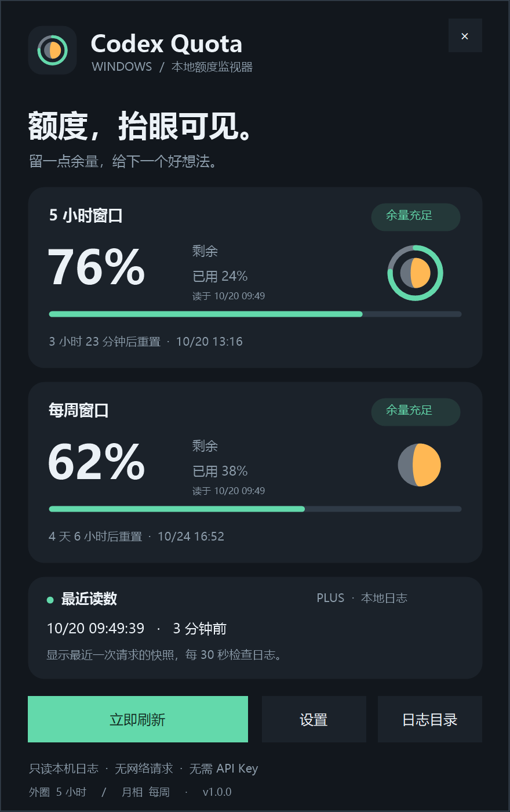
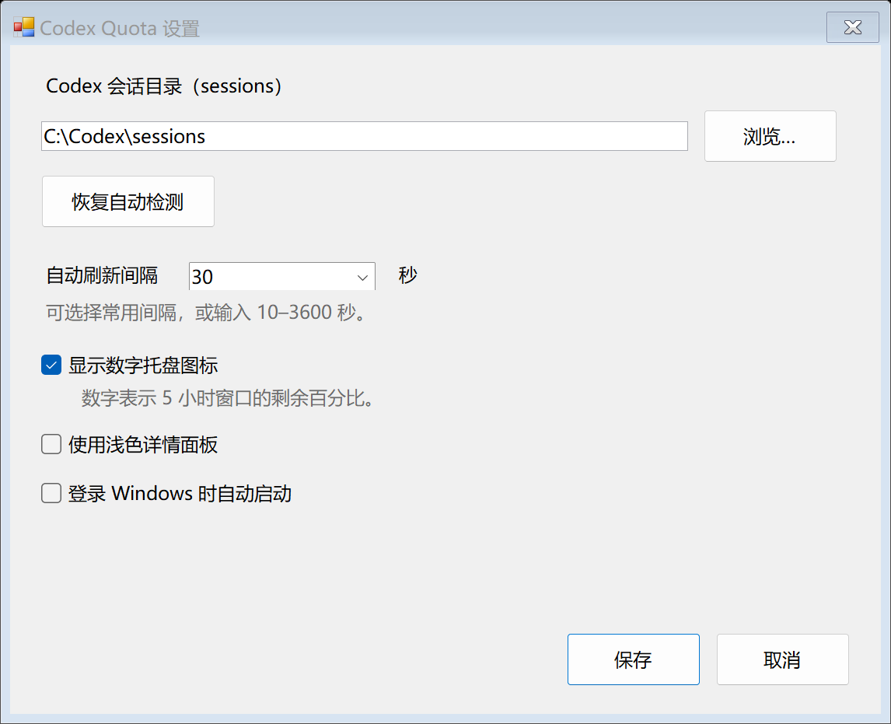
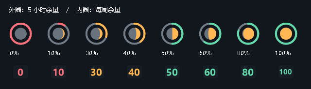

# Codex Quota for Windows

Windows 10 / 11 通知区域中的 Codex 额度监视器。**免安装、运行时离线、无需 API Key**。

外圈显示 5 小时额度余量，内圈用七档月相显示每周余量。月亮越圆，余量越多；数字图标让你直接看到剩余百分比。

<p align="center"></p>

当前版本：**v1.0.2**。参考 [Phil520/CodexO](https://github.com/Phil520/CodexO) 的功能，为 Windows 用 C# + Windows Forms 重新实现。保留原项目 MIT 声明，见 [THIRD_PARTY_NOTICES.md](THIRD_PARTY_NOTICES.md)。本项目是社区工具。

## 下载与启动

1. 打开 [Releases](https://github.com/taonian1989-hub/codex-quota-windows/releases/latest)。
2. 下载 **CodexQuota-1.0.2-windows.zip**，解压到任意文件夹。
3. 双击 **CodexQuota.exe**。不需要管理员权限。

系统要求：Windows 10 / 11，.NET Framework 4.8。程序没有第三方运行依赖；如系统缺少 .NET Framework 4.8，需先安装该运行环境。

Windows 可能把新图标放进任务栏的「^」隐藏区域，可手动拖到任务栏。左键点击任一图标打开或隐藏面板，右键打开操作菜单；关闭面板会保留托盘，完全退出使用右键菜单「退出 Codex Quota」。重复启动会唤出已运行实例。

发布资产包含 SHA256SUMS.txt，可用以下命令核对下载文件：

```powershell
Get-FileHash .\CodexQuota-1.0.2-windows.zip -Algorithm SHA256
```

## 设置窗口

刷新间隔支持常用秒数下拉选择，以及 10–3600 秒自定义输入。设置使用 DPI 一致的字体与自适应布局，较小窗口可滚动查看，底部按钮保持可见。



## 功能

- 5 小时窗口与每周窗口的剩余 / 已用百分比、重置倒计时。
- 绿 / 橙 / 红进度环、七档月相和可关闭的数字图标。
- 每个窗口自己的读数时间、陈旧提示、无数据状态。
- 手动强制刷新、10–3600 秒自动刷新（默认 30 秒）。
- 深色 / 浅色面板、日志目录选择、可选 Windows 登录自启。
- 单实例、Esc 隐藏、F5 刷新、顶部拖动。
- 本地诊断导出，超过 512 KB 滚动一份。



## 数据来自哪里

默认读取 `$CODEX_HOME\sessions`；未设置 CODEX_HOME 时读取 `%USERPROFILE%\.codex\sessions`。可在设置中选择其他 sessions 目录。[官方文档](https://learn.chatgpt.com/docs/reference/troubleshooting) 说明了会话日志的默认位置。

只解析 `.jsonl` 中 `event_msg / token_count / payload.rate_limits` 的额度字段。不读取 auth.json，不启动 Codex 子进程，不连接网络，不上传数据。

**数值是最近一次 Codex 请求写入日志的快照，不是服务器实时查询结果。** 停用 Codex 后，手动刷新只会重读日志；没有新事件就没有新数值。

- 剩余 = 100 − used_percent，真实 0% 与未知分开。
- 两个窗口独立回溯非空读数，按事件时间跨文件比较。
- 超过 10 分钟标为「读数陈旧」。
- 重置时间已过仍无新读数时保留历史百分比，显示「待更新」，数字图标显示 `--`。
- 缺少 resets_at 时，用事件时间 + window_minutes 估算并标注「预计」。
- model 专属额度不会覆盖 limit_id 为 codex 的通用额度；兼容未提供 limit_id 的旧日志。
- 多账号共用一个日志目录时无法可靠区分账号。部分登录方式不提供订阅额度数据。

扫描在后台进行，自动刷新按每个文件的长度与修改时间缓存；手动刷新绕过缓存。按 256 KB 倒序分块，每文件最多回溯 64 MB，单行上限 4 MB，不递归目录联接。文件无法读取或扫描超出预算会有提示。日志内部格式未来可能变化；按时间追加以外的特殊日志可能存在取数限制。

## 设置、诊断与卸载

设置保存在 `%LOCALAPPDATA%\CodexQuota\settings.json`。自启默认关闭，仅在勾选后写入当前用户的 Windows Run 项，不修改 Codex 配置。

右键「写入诊断日志」生成同目录的 diagnostics.log 并打开文件夹，包含额度、时间、程序状态和源文件路径，不含会话正文或密钥。分享前可移除路径中的用户名。

卸载时先在设置中关闭已启用的登录自启，然后退出程序并删除解压目录。可选删除 `%LOCALAPPDATA%\CodexQuota`。

## 性能优化（v1.0.2）

在同机、同一实际会话目录的 30 秒加速刷新对照中，私有工作集从 44.0 MiB 降至 15.8 MiB。32 份固定日志做 100 次强制扫描时，累计托管分配从 2230.9 MiB 降至 15.9 MiB，耗时从 1965 ms 降至 1047 ms。

优化包含复用读取缓冲、字节预筛与流式 JSON、未变化的图标复用、详情按需创建、隐藏时释放绘图缓冲，以及 32 位优先 CLR 构建。程序不做强制 GC 或工作集裁剪，刷新间隔、功能和操作不变。

内存会随日志与窗口状态波动，以上是本次测量，不是所有机器的固定上限。方法、原始指标与边界见 [性能审查](docs/performance.md)。

## 从源码构建

使用系统的 .NET Framework C# 编译器，不依赖 NuGet 或 .NET SDK，不需要网络：

```powershell
powershell.exe -NoProfile -ExecutionPolicy Bypass -File .\build.ps1
powershell.exe -NoProfile -ExecutionPolicy Bypass -File .\build.ps1 -Test -OutputDirectory work\verification_build
```

默认以 AnyCPU / 32 位优先模式构建，减少托盘工具的 CLR 与对象开销；仍支持 Windows 10 / 11 与 .NET Framework 4.8。需要原生 AnyCPU 构建时可传入 -Platform anycpu。默认构建到根目录，兼容已有 Start.cmd 启动入口。根目录 CodexQuota.exe 为本机既有运行入口，不纳入 Git；使用 OutputDirectory 可以在不影响已运行程序的情况下构建。正式新增发布包统一进入 outputs/，中间文件进入 work/。

生成发布包（会重新构建并运行测试）：

```powershell
powershell.exe -NoProfile -ExecutionPolicy Bypass -File .\package.ps1
```

输出 `outputs/CodexQuota-1.0.2-windows.zip` 与 `outputs/SHA256SUMS.txt`。ZIP 内另附程序文件的校验值、使用说明和许可证。

## 验收与命令行

45 项测试覆盖跨文件时间戳、时区、空窗口、畸形事件、UTF-8 分块、尾部半行、缓存、截断与删除、并发写入、扫描预算、月相像素和原生按钮。另含 4000 次图标创建与释放的 GDI / USER 句柄检查。详情见 [验证记录](docs/VALIDATION.md)。

```powershell
Start-Process .\CodexQuota.exe -ArgumentList '--inspect --output inspection.json' -Wait
Start-Process .\CodexQuota.exe -ArgumentList '--smoke --output smoke.json' -Wait
Start-Process .\CodexQuota.exe -ArgumentList '--render --demo --output work\previews' -Wait
```

`--inspect` 输出额度 JSON 后退出；有数据返回 0，无数据返回 2，失败返回 1。`--smoke` 临时创建托盘、后台读数，5 秒后退出。`--render --demo` 生成明确的示例图；正常运行使用真实日志。`--sessions "绝对路径"` 指定本次日志目录，`--background` 仅显示托盘。

## 项目结构与工作区兼容

| 路径 | 用途 |
| --- | --- |
| src/ | 日志、图标、界面、托盘、设置源码 |
| tests/ | 自动化回归与资源检查 |
| docs/ | 示例预览、验证与版本说明 |
| build.ps1 | 本地编译和测试 |
| tools/PerformanceBench.cs | 扫描分配、私有工作集和窗口生命周期对照 |
| package.ps1 | 构建、测试、打包、校验 |
| outputs/ | 正式发布 ZIP 与校验文件，不纳入 Git |
| work/ | 临时构建和发布准备，不纳入 Git |

本机继续复用项目 `project001_codex-tool-01`，当前目录 `D:\Codex\project001_codex-tool-01`。历史目录 `D:\Codex\codex-tool-01` 经 `D:\Codex\project013_codex-tool-01` 更正到当前目录；原始工作区登记全文保存在本机 work/README_before_github_release_20261020.md。历史原文不改写。此登记仅用于路径兼容，不影响其他用户解压或克隆的位置。

## License

[MIT](LICENSE)。参考项目的原始 MIT 声明保留于 [THIRD_PARTY_NOTICES.md](THIRD_PARTY_NOTICES.md)。
